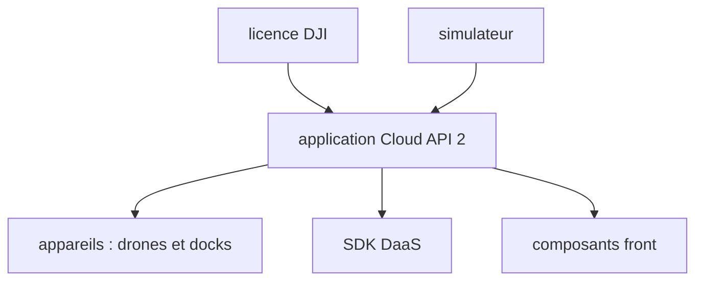

# dji-sdk/Cloud-API-2

> Plateforme ouverte de DJI pour intégrer drones et docks : SDK, composants, simulateur et démos.

## Le problème
Intégrer des drones DJI à un logiciel métier oblige à réimplémenter le protocole de communication cloud.

## Ce que ça fait vraiment
Fournit un SDK DaaS orienté objet, des composants front (cockpit, éditeur de routes, journaux de vol), un simulateur d'appareils, un plugin IA et des démos. Fonctions couvertes : gestion d'appareils, direct vidéo, commande à distance, médias, routes et missions. Licence d'usage gratuite à demander.

## Comment c'est branché
Schéma simplifié d'après la fiche, sans diagramme fourni.

## Essayer
Étapes du README : demander la licence, déployer l'application, connecter les appareils, configurer l'authentification, intégrer composants puis SDK. Aucune commande fournie.

## Coût et pièges
Gratuit mais licence à demander sur la plateforme développeurs DJI, avec identité vérifiée pour les ateliers. README en chinois ; code principal hébergé hors dépôt (téléchargements).

## Ce que ce n'est pas
Pas un produit autonome : il suppose du matériel DJI ou son simulateur.

## Alternatives
Aucune alternative nommée.

## Pour toi
À ignorer : intégration de drones, hors data/IA/MLOps.

