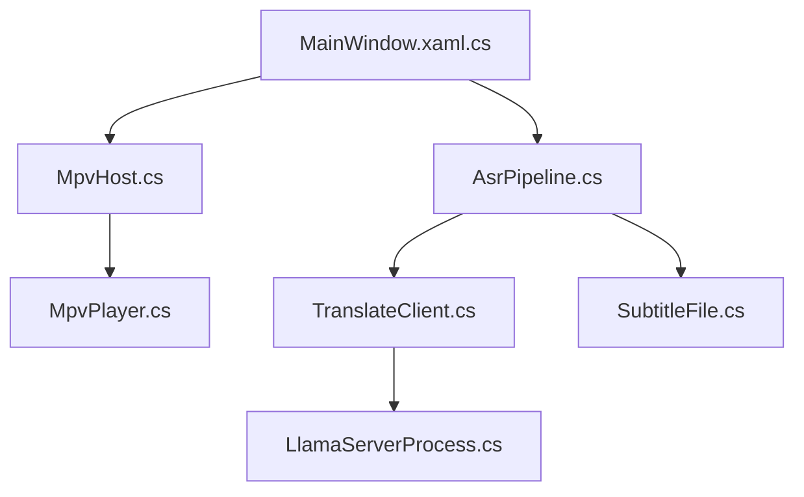

# dlsandy/Transub-Player

> Windows video player that generates and translates subtitles live, using Whisper locally.

## The problem
Watching a foreign film or anime without a subtitle file forces you to look for subtitles before playing.

## What it actually does
WPF interface and mpv player. Speech recognition runs with whisper.cpp (GGML turbo model downloaded on demand), translation with llama-server and a Hy-MT GGUF model. Display translation, source or both, network streams, recording, playback from a phone over the local network, LUT colour grading. Subtitles arrive slightly late.

## How it is wired


## Trying it
```bash
powershell -ExecutionPolicy Bypass -File tools\fetch-mpv.ps1
dotnet run --project src\TransubPlayer\TransubPlayer.csproj
```

## Cost and gotchas
Free. Windows 10/11 64-bit; network required on first launch to download the models; GPU optional. No licence declared: usage and redistribution are unclear.

## What it is not
Not a broadcast-quality subtitle tool: the README points to the companion product Transub for that.

## Alternatives
Transub (companion product) for quality subtitles.

## For you
Worth watching: a concrete example of Whisper and a local LLM assembled into a player, but Windows only and no licence.
