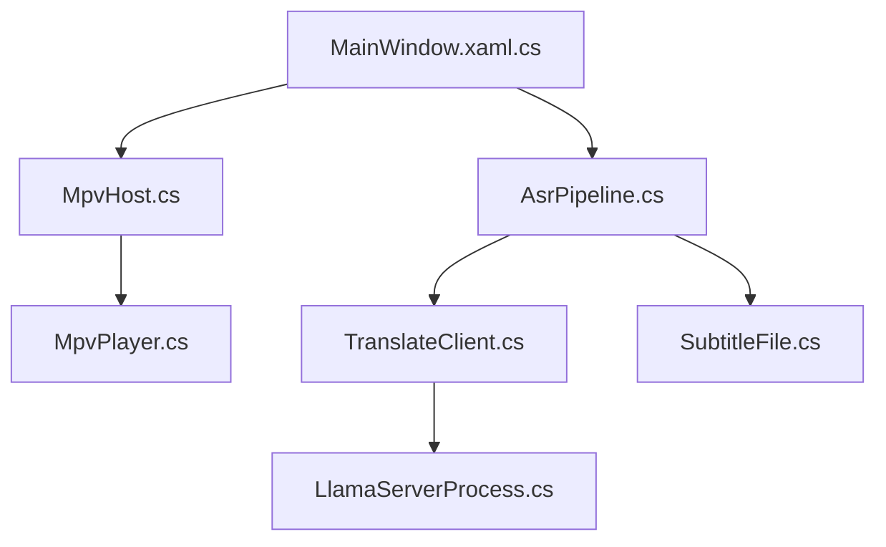

# dlsandy/Transub-Player

> Lecteur vidéo Windows qui génère et traduit les sous-titres en direct avec Whisper en local.

## Le problème
Regarder un film ou un anime étranger sans fichier de sous-titres oblige à les chercher avant de lire.

## Ce que ça fait vraiment
Interface WPF et lecteur mpv. La reconnaissance vocale tourne avec whisper.cpp (modèle GGML turbo téléchargé à la demande), la traduction avec llama-server et un modèle Hy-MT GGUF. Affichage traduction, source ou double, flux réseau, enregistrement, lecture depuis un téléphone via le réseau local, étalonnage LUT. Les sous-titres arrivent légèrement en retard.

## Comment c'est branché


## Essayer
```bash
powershell -ExecutionPolicy Bypass -File tools\fetch-mpv.ps1
dotnet run --project src\TransubPlayer\TransubPlayer.csproj
```

## Coût et pièges
Gratuit. Windows 10/11 64 bits ; réseau requis au premier lancement pour télécharger les modèles ; GPU facultatif. Aucune licence déclarée : usage et redistribution flous.

## Ce que ce n'est pas
Pas un outil de sous-titres de qualité de diffusion : le README renvoie au produit compagnon Transub pour cela.

## Alternatives
Transub (produit compagnon) pour des sous-titres de qualité.

## Pour toi
À surveiller : exemple concret de Whisper et d'un LLM local assemblés en un lecteur, mais Windows seulement et licence absente.

