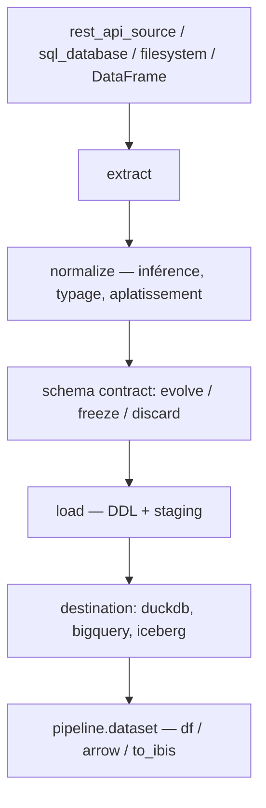

# dlt-hub/dlt

> Python library that loads messy sources into typed destinations.

## The problem
Writing an ingestion pipeline means rewriting pagination, schema inference, typing, staging and schema drift every time.
Platforms that do this for you impose their environment and their black boxes.

## What it actually does
`rest_api_source` describes an API declaratively — client, paginator, resources, filters and maps applied to the source — and dlt handles requests, schema and types.
Any Python iterable becomes a resource: a decorated generator is enough, and `primary_key` + `write_disposition="merge"` give you upsert.
Changing the `destination` string is enough to go from DuckDB to Snowflake, BigQuery, Postgres, Redshift, Databricks, Athena, ClickHouse, Iceberg or Delta: credentials, DDL, type mapping, staging and `ALTER TABLE` follow.
Schema contracts (`evolve`, `freeze`, `discard`) apply separately to tables, columns and types; the Dataset API then reads back as a DataFrame, zero-copy Arrow or an Ibis expression compiled to SQL.

## How it is wired


## Trying it
```bash
pip install dlt
pip install "dlt[duckdb]"
pip install "dlt[sql_database]"
```

## Cost and gotchas
Free and with no service to create: you only pay for your destination. Python 3.10 to 3.14, but 3.14 is declared experimental because some extras are missing.
Follow the recommended versioning (`dlt~=1.23.0`, patch only): minor versions sometimes bring automatic migrations.

## What it is not
It is not a platform: no scheduler, no UI, no orchestration — it is a `pip install` in your existing code.
Nor is it open to destination contributions: the README announces that new destinations will probably not be merged, because of maintenance cost.

## Alternatives
No competitor is named in the README; it points to its own ecosystem of sources and to `dlt[hub]` for data quality and transformations.

## For you
The reasonable default for any Python ingestion: typing, incremental merge and Arrow/Ibis read-back with no platform to install.
