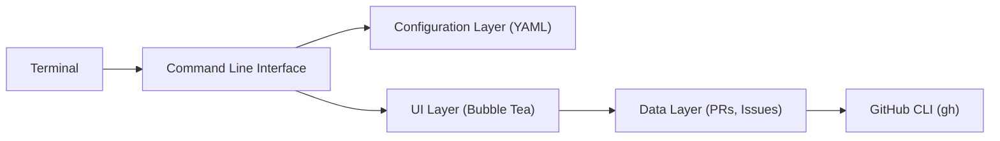

# dlvhdr/gh-dash

> Terminal interface to track your GitHub pull requests and issues from the keyboard.

## The problem
Switching from one repository to another in the browser to find your PRs and issues to handle breaks the work rhythm.

## What it actually does
A TUI dashboard with user-defined sections of PRs and issues, per repository. Vim-like keyboard shortcuts that can be changed, custom actions, everything configured by a YAML file. Relies on `gh` for GitHub and on delta for diffs.

## How it is wired

## Trying it
No installation command in the README; it points to the site gh-dash.dev/getting-started.

## Cost and gotchas
Free. Requires `gh` and a GitHub account. Installation not documented in the README.

## What it is not
Not a replacement for GitHub: it consumes the API through `gh`. Main author cited: Dolev Hadar "and the community".

## Alternatives
No alternative named in the README.

## For you
Watch: comfortable if you live in the terminal and handle many PRs, with no direct link to data or AI.
