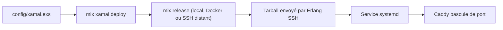

# dmkenney/xamal

> Elixir port of Kamal: deploys an Elixir app to Linux servers via Mix tasks and Caddy.

## The problem
Deploying an Elixir release to servers without Docker requires hand-made SSH, systemd and proxy scripts.

## What it actually does
Builds a release with `mix release`, sends it as a tarball over SSH (Erlang SSH, connection pool) and starts it under systemd. Caddy handles Let's Encrypt TLS and switches over with no downtime by alternating two ports. Config in `config/xamal.exs`, shell hooks, destinations (staging, production), deploy lock.

## How it is wired
Simplified diagram based on the sheet, no diagram provided.


## Trying it
```bash
mix deps.get
mix xamal.init
mix xamal.setup
mix xamal.deploy -d staging
```

## Cost and gotchas
Free. Requires Elixir 1.15+ / OTP 26+ locally and systemd servers with SSH. The `release.name` must exist in `mix.exs`, otherwise `Unknown release`. Binaries tied to the OpenSSL and glibc of the build machine.

## What it is not
Not a Docker tool: everything related to images and registries is deliberately omitted. Not Kamal itself, and migrating from version 0.2.0 breaks the interface.

## Alternatives
- Kamal: the original, for deploying Docker containers.

## For you
Watch: useful only if you deploy Elixir, no direct interest for a data / AI / MLOps profile, and a young project carried by one person.
