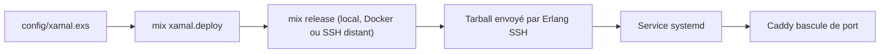

# dmkenney/xamal

> Port Elixir de Kamal : déploie une appli Elixir sur des serveurs Linux via tâches Mix et Caddy.

## Le problème
Déployer une release Elixir sur des serveurs sans passer par Docker demande des scripts SSH, systemd et proxy faits main.

## Ce que ça fait vraiment
Construit une release avec `mix release`, l'envoie en tarball par SSH (Erlang SSH, pool de connexions) et la démarre sous systemd. Caddy fait le TLS Let's Encrypt et bascule sans coupure en alternant deux ports. Config dans `config/xamal.exs`, hooks shell, destinations (staging, production), verrou de déploiement.

## Comment c'est branché
Schéma simplifié d'après la fiche, sans diagramme fourni.


## Essayer
```bash
mix deps.get
mix xamal.init
mix xamal.setup
mix xamal.deploy -d staging
```

## Coût et pièges
Gratuit. Il faut Elixir 1.15+ / OTP 26+ en local et des serveurs systemd avec SSH. Le `release.name` doit exister dans `mix.exs`, sinon `Unknown release`. Binaires liés à OpenSSL et glibc de la machine de build.

## Ce que ce n'est pas
Pas un outil Docker : tout ce qui touche image et registre est volontairement omis. Ce n'est pas Kamal lui-même, et la migration depuis la version 0.2.0 casse l'interface.

## Alternatives
- Kamal : l'original, pour déployer des conteneurs Docker.

## Pour toi
Surveiller : utile seulement si tu déploies de l'Elixir, sans intérêt direct pour un profil data / IA / MLOps, et projet jeune porté par une personne.

