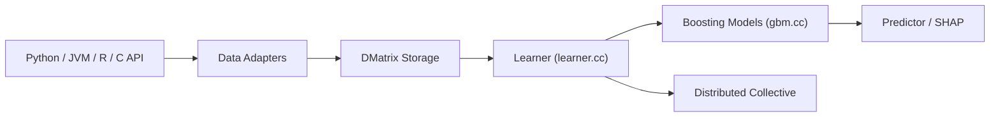

# dmlc/xgboost

> Distributed gradient boosting library for tabular data, in Python, JVM, R and C.

## The problem
Boosted tree models on tabular data must be fast, portable and distributable.

## What it actually does
The bindings (Python, JVM, R, C) build data matrices, a learner computes objectives and metrics and fits trees or linear models, then a predictor returns scores, SHAP explanations or serialized models. Distributed execution via Dask and Spark, external memory, categorical variables, CPU, CUDA and SYCL.

## How it is wired

## Trying it
No command in the README: it refers to the documentation for installation.

## Cost and gotchas
Free. GPU optional. The README does not detail installation; go through the documentation.

## What it is not
Not a deep learning framework; not suited to images or raw text.

## Alternatives
No alternative named in the README.

## For you
Adopt: proven reference for tabular data, Apache-2.0, with explainable outputs and scaling through Dask or Spark.
