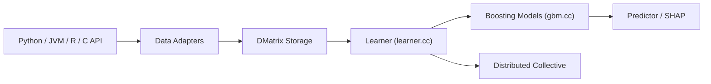

# dmlc/xgboost

> Bibliothèque de gradient boosting distribuée, pour données tabulaires, en Python, JVM, R et C.

## Le problème
Les modèles d'arbres boostés sur données tabulaires doivent être rapides, portables et distribuables.

## Ce que ça fait vraiment
Les liaisons (Python, JVM, R, C) construisent des matrices de données, un apprenant calcule objectifs et métriques et ajuste des arbres ou des modèles linéaires, puis un prédicteur renvoie scores, explications SHAP ou modèles sérialisés. Exécution distribuée via Dask et Spark, mémoire externe, variables catégorielles, CPU, CUDA et SYCL.

## Comment c'est branché

## Essayer
Aucune commande dans le README : renvoi à la documentation pour l'installation.

## Coût et pièges
Gratuit. GPU optionnel. Le README ne détaille pas l'installation ; passer par la documentation.

## Ce que ce n'est pas
Pas un framework de deep learning ; pas adapté à l'image ou au texte brut.

## Alternatives
Aucune alternative nommée dans le README.

## Pour toi
À adopter : référence éprouvée pour le tabulaire, Apache-2.0, avec sorties explicables et passage à l'échelle via Dask ou Spark.

