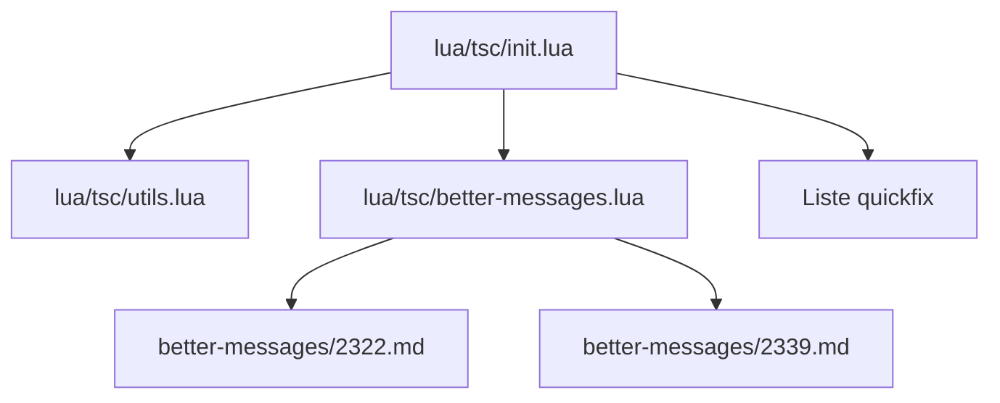

# dmmulroy/tsc.nvim

> Neovim plugin that runs tsc asynchronously and puts TypeScript errors in the quickfix list.

## The problem
Type-checking a whole TypeScript project blocks the editor or forces you to leave Neovim.

## What it actually does
Runs `tsc --noEmit` in the background with the nearest tsconfig, shows progress, then fills the quickfix list. Options: watch mode, monorepo, Trouble, diagnostics, alternative compiler (tsgo). More readable error messages are provided in Markdown.

## How it is wired


## Trying it
```bash
# Dans Neovim, après require('tsc').setup()
:TSC
:TSCStop
:TSCOpen
:TSCClose
```

## Cost and gotchas
Free. TypeScript must be installed in the project or in the PATH. nvim-notify can spam if vim.notify does not return its record.

## What it is not
Not a language server: it launches the compiler. No automatic fixing.

## Alternatives
None named in the README.

## For you
Ignore: only useful for TypeScript under Neovim.
