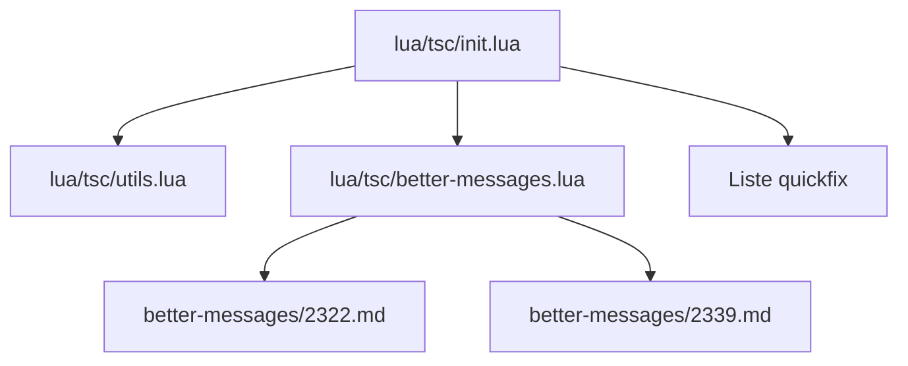

# dmmulroy/tsc.nvim

> Plugin Neovim qui lance tsc en asynchrone et range les erreurs TypeScript dans la liste quickfix.

## Le problème
Vérifier les types d'un projet TypeScript entier bloque l'éditeur ou oblige à quitter Neovim.

## Ce que ça fait vraiment
Exécute `tsc --noEmit` en arrière-plan avec le tsconfig le plus proche, affiche une progression, puis remplit la liste quickfix. Options : mode watch, monorepo, Trouble, diagnostics, compilateur alternatif (tsgo). Des messages d'erreur plus lisibles sont fournis en Markdown.

## Comment c'est branché


## Essayer
```bash
# Dans Neovim, après require('tsc').setup()
:TSC
:TSCStop
:TSCOpen
:TSCClose
```

## Coût et pièges
Gratuit. Il faut TypeScript installé dans le projet ou dans le PATH. nvim-notify peut spammer si vim.notify ne renvoie pas son enregistrement.

## Ce que ce n'est pas
Pas un serveur de langage : il lance le compilateur. Pas de correction automatique.

## Alternatives
Aucune nommée dans le README.

## Pour toi
À ignorer : seulement utile pour du TypeScript sous Neovim.

