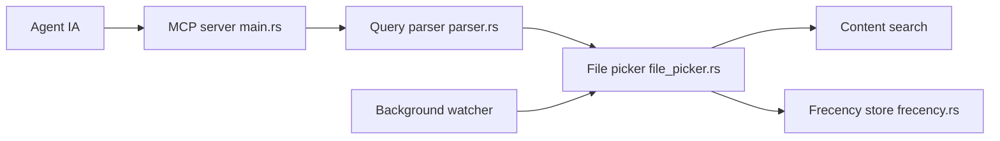

# dmtrKovalenko/fff

> Fast Rust library for file and content search, for editors and AI agents.

## The problem
An agent that runs hundreds of `rg` calls pays for process startup and a repository re-scan every time.

## What it actually does
Keeps an index of files and content in memory, updated by a watcher. Typo-tolerant fuzzy search, ranking by usage frequency, git annotation, definition detection. Exposed as an MCP server (`grep`, `find_files`, `multi_grep`), Neovim plugin, Pi extension, Node/Bun SDK, Python, Rust crate and C library.

## How it is wired


## Trying it
```bash
curl -L https://dmtrkovalenko.dev/install-fff-mcp.sh | bash
brew install dmtrKovalenko/fff/fff-mcp
codex mcp add fff -- "$(brew --prefix)/bin/fff-mcp"
pip install fff-search
```

## Cost and gotchas
Free. Uses memory: about 26 MB for 14,000 files, a few hundred MB for Chromium. The install script goes through `curl | bash`. Node installation section truncated in the README.

## What it is not
Not a replacement for ripgrep for a one-off terminal search: the README admits that `rg` remains suitable. The announced speed gains are the author's own.

## Alternatives
- ripgrep: simpler for an occasional grep.
- fzf: fuzzy filter without usage-based ranking.

## For you
Adopt if you equip coding agents on large repositories: the resident index cuts round trips, and the MCP installs in one command.
