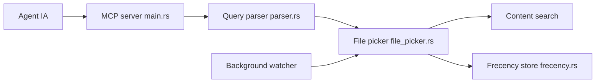

# dmtrKovalenko/fff

> Bibliothèque Rust de recherche de fichiers et de contenu, rapide, pour éditeurs et agents IA.

## Le problème
Un agent qui lance des centaines de `rg` paie à chaque fois le démarrage du processus et le re-scan du dépôt.

## Ce que ça fait vraiment
Garde en mémoire un index de fichiers et de contenu, mis à jour par un observateur. Recherche floue tolérante aux fautes, classement par fréquence d'usage, annotation git, détection de définitions. Exposée en serveur MCP (`grep`, `find_files`, `multi_grep`), plugin Neovim, extension Pi, SDK Node/Bun, Python, crate Rust et bibliothèque C.

## Comment c'est branché


## Essayer
```bash
curl -L https://dmtrkovalenko.dev/install-fff-mcp.sh | bash
brew install dmtrKovalenko/fff/fff-mcp
codex mcp add fff -- "$(brew --prefix)/bin/fff-mcp"
pip install fff-search
```

## Coût et pièges
Gratuit. Consomme de la mémoire : environ 26 Mo pour 14 000 fichiers, quelques centaines de Mo pour Chromium. Le script d'installation passe par `curl | bash`. Section d'installation Node tronquée dans le README.

## Ce que ce n'est pas
Pas un remplaçant de ripgrep pour une recherche unique en terminal : le README admet que `rg` reste adapté. Les gains de vitesse annoncés sont ceux de l'auteur.

## Alternatives
- ripgrep : plus simple pour un grep ponctuel.
- fzf : filtre flou sans classement par usage.

## Pour toi
À adopter si tu outilles des agents de code sur de gros dépôts : l'index résident réduit les allers-retours, et le MCP s'installe en une commande.

