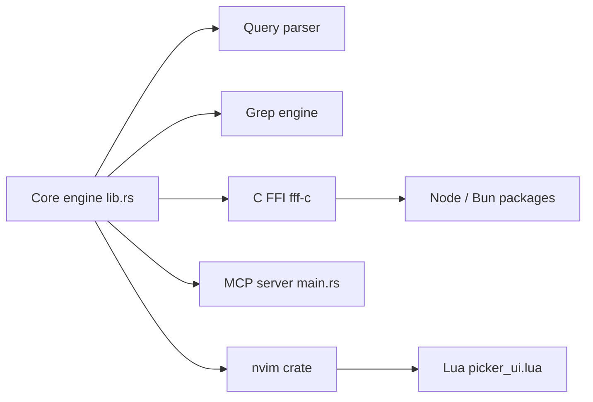

# dmtrKovalenko/fff.nvim

> A fast Rust file and content search library, for editors and AI agents.

## The problem
ripgrep and fzf relaunch a process and re-read the tree on every call: costly when an agent searches hundreds of times.

## What it actually does
A memory-resident index, kept up to date by a watcher, with typo-tolerant fuzzy search, ranking by open frequency, git status and definition detection. Exposed as a Neovim picker, MCP server, pi extension, Node/Bun SDK, Rust crate, C library and Python bindings. The README claims 3 to 9 s per rg versus under 10 ms per query on Chromium (author's figures).

## How it is wired


## Trying it
```bash
curl -L https://dmtrkovalenko.dev/install-fff-mcp.sh | bash
brew install dmtrKovalenko/fff/fff-mcp
codex mcp add fff -- "$(brew --prefix)/bin/fff-mcp"
pip install fff-search
```

## Cost and gotchas
Free; the index uses RAM (about 36 MB for 100,000 files, a few hundred MB on Chromium). A `curl | bash` to review before running.

## What it is not
Not a replacement for rg for a single shell search: it loses on "one grep then exit". Not a persistent full-text engine like Tantivy.

## Alternatives
- ripgrep: better for an isolated call.
- fzf: pure selector, no usage-based ranking.
- Tantivy: full-text index at large scale.

## For you
Adopt the MCP tool for your coding agents: real gain on repeated searches and MIT license; the Python bindings are also useful in notebook scripts.
