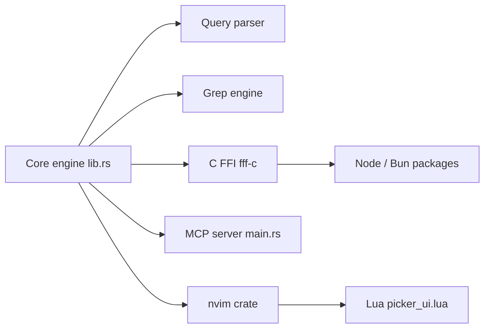

# dmtrKovalenko/fff.nvim

> Une bibliothèque Rust de recherche de fichiers et de contenu, rapide, pour éditeurs et agents IA.

## Le problème
ripgrep et fzf relancent un processus et relisent l'arborescence à chaque appel : coûteux quand un agent cherche des centaines de fois.

## Ce que ça fait vraiment
Un index résident en mémoire, mis à jour par un watcher, avec recherche floue tolérante aux fautes, classement par fréquence d'ouverture, statut git et détection de définitions. Exposé en picker Neovim, serveur MCP, extension pi, SDK Node/Bun, crate Rust, bibliothèque C et bindings Python. Le README annonce 3 à 9 s par rg contre moins de 10 ms par requête sur Chromium (chiffres de l'auteur).

## Comment c'est branché


## Essayer
```bash
curl -L https://dmtrkovalenko.dev/install-fff-mcp.sh | bash
brew install dmtrKovalenko/fff/fff-mcp
codex mcp add fff -- "$(brew --prefix)/bin/fff-mcp"
pip install fff-search
```

## Coût et pièges
Gratuit ; l'index consomme de la RAM (environ 36 Mo pour 100 000 fichiers, quelques centaines de Mo sur Chromium). Un `curl | bash` à relire avant exécution.

## Ce que ce n'est pas
Pas un remplaçant de rg pour une recherche unique en shell : il perd sur « un grep puis exit ». Pas un moteur plein texte persistant comme Tantivy.

## Alternatives
- ripgrep : meilleur pour un appel isolé.
- fzf : sélecteur pur, sans classement par usage.
- Tantivy : index plein texte à grande échelle.

## Pour toi
Adopter l'outil MCP pour tes agents de code : gain réel sur les recherches répétées et licence MIT ; les bindings Python servent aussi dans des scripts de notebooks.

