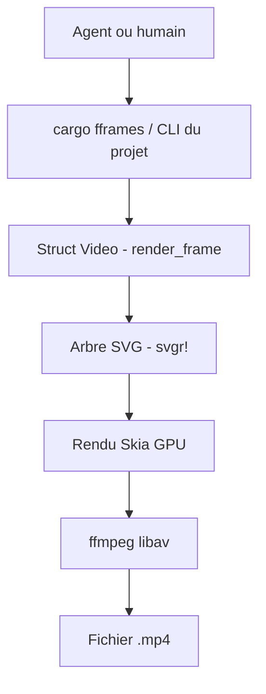

# dmtrKovalenko/fframes

> Rust framework that produces videos from SVG trees, GPU-rendered, designed to be driven by an agent.

## The problem
Generating a video from code usually requires manual editing or slow rendering, and an agent can neither watch nor listen to it to fix it.

## What it actually does
Each frame is an SVG tree returned by a Rust function (`svgr!` macro), with timeline animations. Rendering goes through Skia on the GPU (Metal or Vulkan) and links ffmpeg's libav libraries. A CLI gives the agent eyes and ears: `inspect`, `strip`, `onion`, `frame`, `audio analyze`, plus `preview` and `render`. An agent skill guides from the empty folder to the `.mp4`.

## How it is wired
Simplified diagram based on the fiche, no diagram provided.



## Trying it
```bash
npx skills add https://fframes.studio

cargo install --locked cargo-fframes
cargo fframes new my-video
cd my-video && cargo run --release -- preview
```

## Cost and gotchas
Free. First build: under a minute on macOS and Linux (precompiled libraries), up to about 20 minutes elsewhere. System packages are needed (nasm, clang, codecs). On Windows, a shared ffmpeg 9.0 must be provided.

## What it is not
It is not a visual video editor nor an AI video generator: you (or your agent) write explicit, verbose Rust. Fast rendering assumes a compatible GPU.

## Alternatives
No alternative named in the README.

## For you
Worth watching: useful if you want to automate demo or results videos via an agent, but you must accept Rust and a GPU, and the project relies on a single author.
