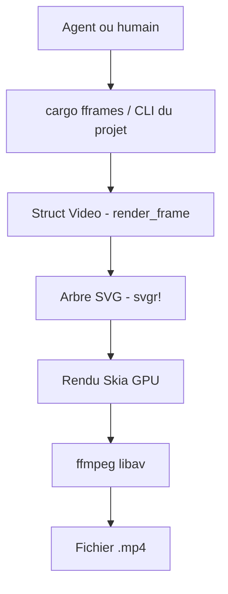

# dmtrKovalenko/fframes

> Framework Rust qui produit des vidéos à partir d'arbres SVG, rendu sur GPU, pensé pour être piloté par un agent.

## Le problème
Générer une vidéo par code demande d'ordinaire un montage manuel ou un rendu lent, et un agent ne peut ni la regarder ni l'écouter pour la corriger.

## Ce que ça fait vraiment
Chaque image est un arbre SVG retourné par une fonction Rust (macro `svgr!`), avec des animations sur timeline. Le rendu passe par Skia sur GPU (Metal ou Vulkan) et lie les bibliothèques libav de ffmpeg. Une CLI donne à l'agent des yeux et des oreilles : `inspect`, `strip`, `onion`, `frame`, `audio analyze`, plus `preview` et `render`. Un skill pour agents guide du dossier vide au `.mp4`.

## Comment c'est branché
Schéma simplifié d'après la fiche, sans diagramme fourni.



## Essayer
```bash
npx skills add https://fframes.studio

cargo install --locked cargo-fframes
cargo fframes new my-video
cd my-video && cargo run --release -- preview
```

## Coût et pièges
Gratuit. Première compilation : moins d'une minute sur macOS et Linux (bibliothèques précompilées), jusqu'à environ 20 minutes ailleurs. Il faut les paquets système (nasm, clang, codecs). Sous Windows, ffmpeg 9.0 partagé à fournir.

## Ce que ce n'est pas
Ce n'est pas un éditeur vidéo visuel ni un générateur de vidéos par IA : tu (ou ton agent) écris du Rust explicite et verbeux. Le rendu rapide suppose un GPU compatible.

## Alternatives
Aucune alternative nommée dans le README.

## Pour toi
À surveiller : utile si tu veux automatiser des vidéos de démo ou de résultats via un agent, mais il faut accepter Rust et un GPU, et le projet repose sur un seul auteur.

