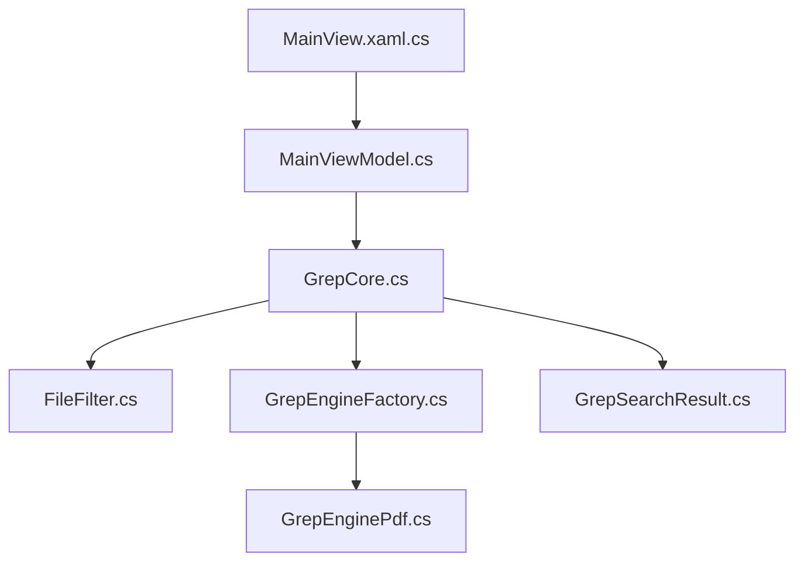

# dnGrep/dnGrep

> Windows utility for searching text, Office, PDF and archive files, for anyone digging through large folders.

## The problem
Windows search cannot search the contents of Office documents, PDFs and archives with regular expressions or phonetic queries.

## What it actually does
Search by text, regex, XPath and phonetics in text files, Word, Excel, PowerPoint, PDF and archives; per-type engines, hexadecimal search, plugin engines. Preview, replacement and results report. Checks for new versions on github.com without sending data (can be disabled).

## How it is wired

## Trying it
No command documented in the README: installation goes through the main website.

## Cost and gotchas
Free. Windows only; MSI installers signed via SignPath since v3.0. GPL-3.0 license (copyleft).

## What it is not
Not a continuous indexing tool nor cross-platform: a Windows desktop application.

## Alternatives
No alternative named in the README.

## For you
Worth watching if you work on Windows with mixed corpora (PDF, Office); otherwise of no interest for MLOps.
