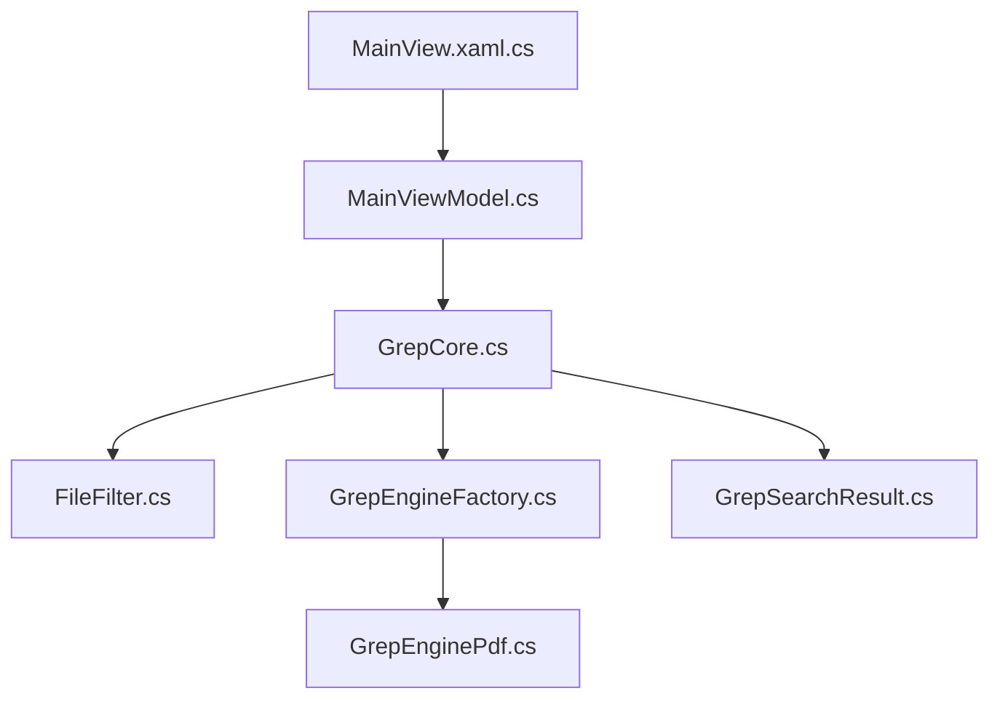

# dnGrep/dnGrep

> Utilitaire Windows de recherche dans les fichiers texte, Office, PDF et archives, pour qui fouille de gros dossiers.

## Le problème
La recherche Windows ne sait pas fouiller le contenu de documents Office, PDF et archives avec expressions régulières ou requêtes phonétiques.

## Ce que ça fait vraiment
Recherche par texte, regex, XPath et phonétique dans fichiers texte, Word, Excel, PowerPoint, PDF et archives ; moteurs par type, recherche hexadécimale, moteurs en plugin. Aperçu, remplacement et rapport des résultats. Vérifie les nouvelles versions sur github.com sans envoyer de données (désactivable).

## Comment c'est branché

## Essayer
Aucune commande documentée dans le README : l'installation passe par le site principal.

## Coût et pièges
Gratuit. Windows uniquement ; installateurs MSI signés via SignPath depuis la v3.0. Licence GPL-3.0 (copyleft).

## Ce que ce n'est pas
Pas un outil d'indexation continue ni multiplateforme : une application de bureau Windows.

## Alternatives
Aucune alternative nommée dans le README.

## Pour toi
À surveiller si tu travailles sous Windows avec des corpus mixtes (PDF, Office) ; sinon sans intérêt pour du MLOps.

