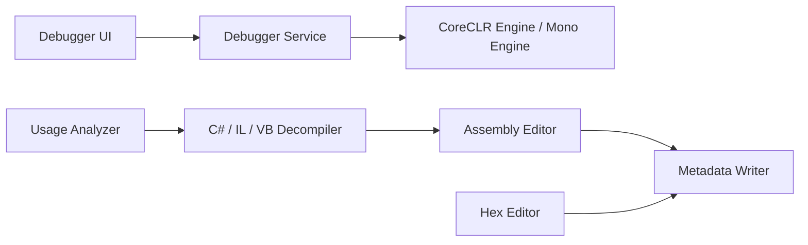

# dnSpy/dnSpy

> Debugger and editor for .NET and Unity assemblies, usable without source code, for reverse engineering.

## The problem
Understanding or fixing a .NET binary when the source code is not available.

## What it actually does
Opens an assembly, decompiles it to C#, VB or IL, and lets you debug it (breakpoints, variables, multiple processes, dynamic modules). You can edit methods and classes in C#/VB, modify metadata and IL, and inspect byte by byte in a hex editor. It bundles ILSpy, Roslyn, dnlib and other libraries.

## How it is wired


## Trying it
```bash
git clone --recursive https://github.com/dnSpy/dnSpy.git
cd dnSpy
./build.ps1 -NoMsbuild
```

## Cost and gotchas
Free, Windows. To debug Unity games, you need the binaries or the dnSpy-Unity-mono repository. Archived repository, last push in 2020: expect no fixes.

## What it is not
Not maintained. No license declared in the catalog: reusing the code is legally uncertain. Not an everyday development tool.

## Alternatives
None cited in the README.

## For you
Ignore: archived since 2020, unlicensed, and oriented toward .NET reverse engineering, outside your data/AI scope.
