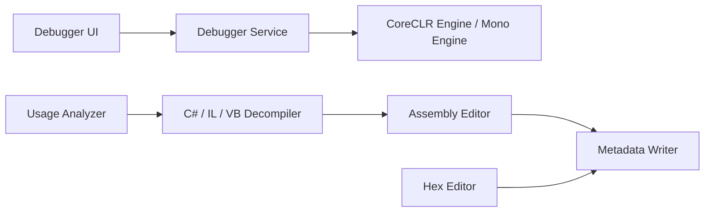

# dnSpy/dnSpy

> Débogueur et éditeur d'assemblages .NET et Unity, utilisable sans code source, pour la rétro-ingénierie.

## Le problème
Comprendre ou corriger un binaire .NET quand le code source n'est pas disponible.

## Ce que ça fait vraiment
Ouvre un assemblage, le décompile en C#, VB ou IL, et permet de le déboguer (points d'arrêt, variables, plusieurs processus, modules dynamiques). On peut éditer méthodes et classes en C#/VB, modifier les métadonnées et l'IL, et inspecter l'octet près à l'octet dans un éditeur hexadécimal. Il embarque ILSpy, Roslyn, dnlib et d'autres bibliothèques.

## Comment c'est branché


## Essayer
```bash
git clone --recursive https://github.com/dnSpy/dnSpy.git
cd dnSpy
./build.ps1 -NoMsbuild
```

## Coût et pièges
Gratuit, Windows. Pour déboguer des jeux Unity, il faut les binaires ou le dépôt dnSpy-Unity-mono. Dépôt archivé, dernier push en 2020 : aucune correction à attendre.

## Ce que ce n'est pas
Pas maintenu. Aucune licence déclarée dans le catalogue : réutilisation du code juridiquement incertaine. Pas un outil de développement courant.

## Alternatives
Aucune citée dans le README.

## Pour toi
Ignorer : archivé depuis 2020, sans licence, et orienté rétro-ingénierie .NET, hors de ton périmètre data/IA.

