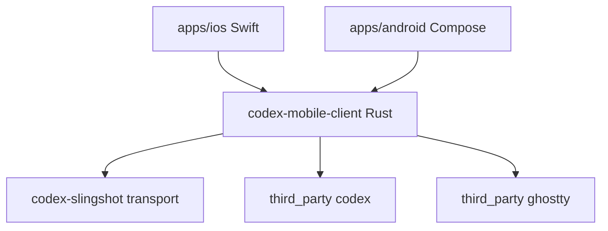

# dnakov/litter

> Native iOS and Android client to drive Codex and Local Studio from your phone.

## The problem
Launching and following agent coding sessions when you are away from your workstation.

## What it actually does
Connects to local or remote servers, manages sessions and launches agentic workflows. A shared Rust core (codex-mobile-client) via UniFFI handles session state, streaming, reconnection, SSH and authentication. Swift and Kotlin keep only the interface and platform APIs. Codex and Ghostty are submodules.

## How it is wired
Simplified diagram based on the fiche, no diagram provided.


## Trying it
```bash
make ios-device-fast
make ios-sim-fast
make android-emulator-fast
make watch-register
```

## Cost and gotchas
No announced binary: you build it yourself (Xcode, Rust, Gradle, not detailed here). An Apple developer account is mentioned for the Apple Watch. License present but not identified. The Codex server to control is not provided.

## What it is not
Not a coding agent: only a mobile remote control for an existing Codex.

## Alternatives
No alternative named in the README.

## For you
Watch: useful if you delegate code to agents and want to supervise them on the go, but still young and to be built yourself.
