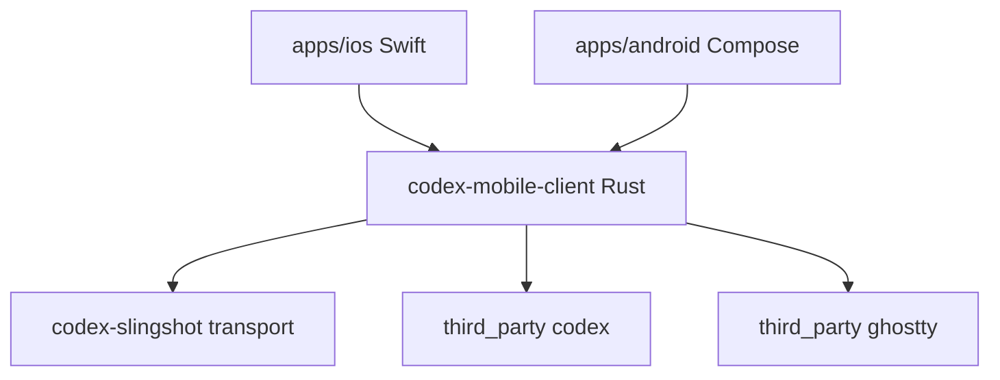

# dnakov/litter

> Client iOS et Android natif pour piloter Codex et Local Studio depuis son téléphone.

## Le problème
Lancer et suivre des sessions de codage par agent quand on est loin de son poste.

## Ce que ça fait vraiment
Se connecte à des serveurs locaux ou distants, gère les sessions et lance des workflows agentiques. Un noyau Rust partagé (codex-mobile-client) via UniFFI gère l'état des sessions, le streaming, la reconnexion, SSH et l'authentification. Swift et Kotlin ne gardent que l'interface et les API de plateforme. Codex et Ghostty sont des sous-modules.

## Comment c'est branché
Schéma simplifié d'après la fiche, sans diagramme fourni.


## Essayer
```bash
make ios-device-fast
make ios-sim-fast
make android-emulator-fast
make watch-register
```

## Coût et pièges
Pas de binaire annoncé : on compile soi-même (Xcode, Rust, Gradle, non détaillés ici). Un compte développeur Apple est évoqué pour l'Apple Watch. Licence présente mais non identifiée. Le serveur Codex à contrôler n'est pas fourni.

## Ce que ce n'est pas
Pas un agent de codage : seulement une télécommande mobile vers un Codex existant.

## Alternatives
Aucune alternative nommée dans le README.

## Pour toi
À surveiller : utile si tu délègues du code à des agents et veux les superviser en mobilité, mais encore jeune et à compiler soi-même.

