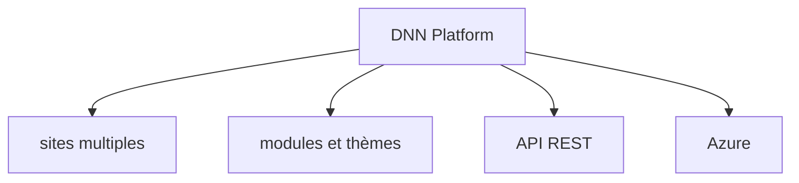

# dnnsoftware/Dnn.Platform

> Open-source content management system from the Microsoft ecosystem, formerly DotNetNuke, for websites and intranets.

## The problem
Building a multi-site website with roles, localization and extensions requires a complete platform.

## What it actually does
A .NET CMS with multi-site installation, file management, six languages, themes, hundreds of REST APIs, roles, SEO, a scheduler and extensibility through modules (DNN store). Azure compatible. It claims more than 8 million downloads. Backed by the .NET Foundation.

## How it is wired
Simplified diagram based on the sheet, no diagram provided.

## Trying it
No command in the README: see the linked Build and Contribute pages.

## Cost and gotchas
Free. Windows and .NET ecosystem. 343 open issues. Commercial extensions are possible through the store.

## What it is not
Not a data framework: it is a CMS oriented toward websites.

## Alternatives
No alternative named in the README.

## For you
Ignore: .NET CMS, outside data / AI / MLOps scope.
