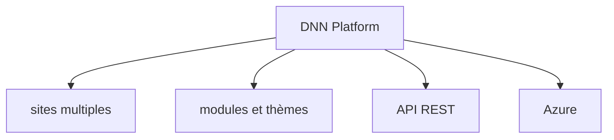

# dnnsoftware/Dnn.Platform

> Système de gestion de contenu open source de l'écosystème Microsoft, ex-DotNetNuke, pour sites et intranets.

## Le problème
Construire un site multi-sites avec rôles, localisation et extensions demande une plateforme complète.

## Ce que ça fait vraiment
Un CMS .NET avec installation multi-sites, gestion de fichiers, six langues, thèmes, centaines d'API REST, rôles, SEO, planificateur et extensibilité par modules (boutique DNN). Compatible Azure. Il revendique plus de 8 millions de téléchargements. Pris en charge par la .NET Foundation.

## Comment c'est branché
Schéma simplifié d'après la fiche, sans diagramme fourni.

## Essayer
Aucune commande dans le README : voir les pages Build et Contribute liées.

## Coût et pièges
Gratuit. Écosystème Windows et .NET. 343 tickets ouverts. Extensions commerciales possibles via la boutique.

## Ce que ce n'est pas
Pas un framework de données : c'est un CMS orienté sites web.

## Alternatives
Aucune alternative nommée dans le README.

## Pour toi
Ignorer : CMS .NET, hors périmètre data / IA / MLOps.

