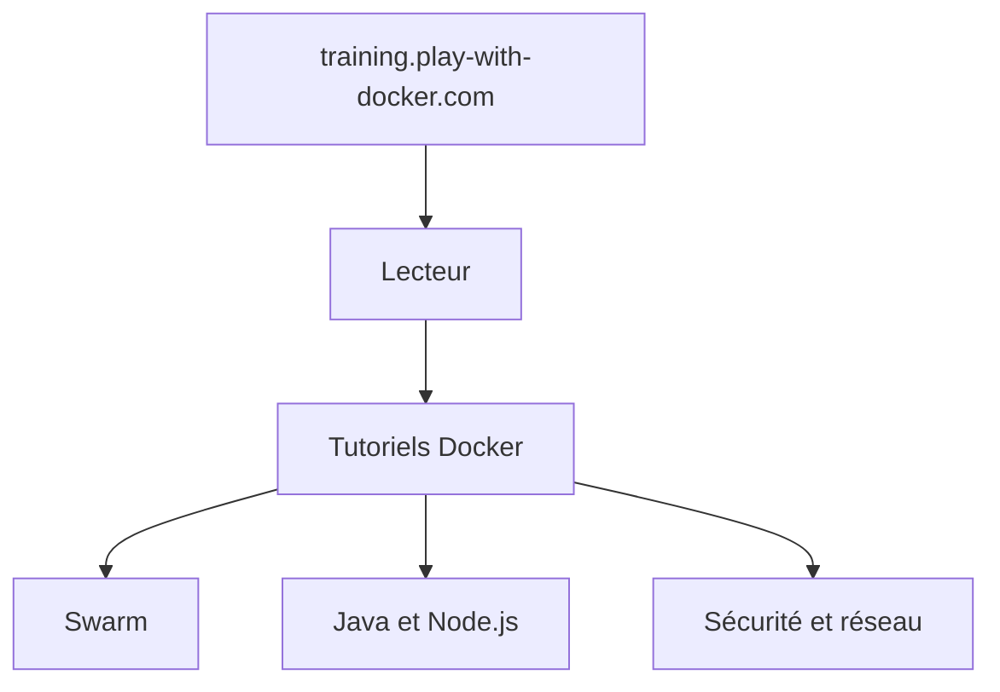

# docker-archive-public/docker.labs

> Former Docker workshops and tutorials, now archived in favor of another site.

## The problem
Learning Docker through hands-on exercises.

## What it actually does
List of tutorials: Docker for beginners, Swarm mode, developer tools, Java, Node.js, ASP.NET and Windows containers, "12-factor" application, security, networking, DockerCon US 2017 workshops. No new content is added; the README points to training.play-with-docker.com.

## How it is wired
Simplified diagram based on the sheet, no diagram provided.

## Trying it
No command documented.

## Cost and gotchas
Free. Archived repository, last push in 2023: the procedures have probably aged.

## What it is not
It is not the home of recent workshops: the README sends you to the training site.

## Alternatives
play-with-docker.github.io, for any new content, and the training.play-with-docker.com site.

## For you
Ignore: archived since 2023; go through the training site indicated.
