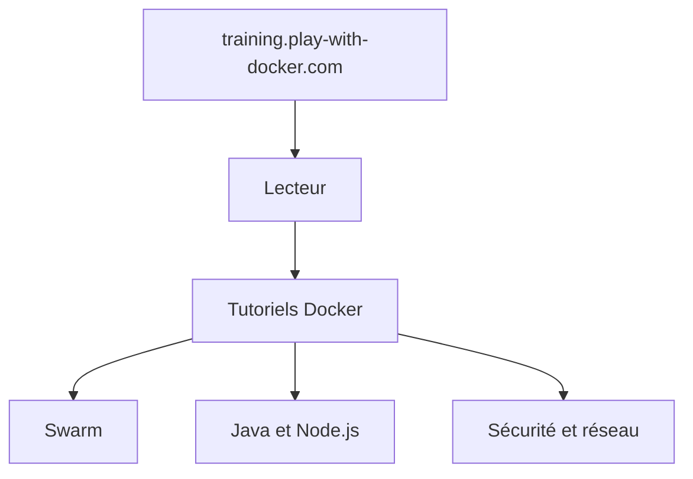

# docker-archive-public/docker.labs

> Anciens ateliers et tutoriels Docker, désormais archivés au profit d'un autre site.

## Le problème
Apprendre Docker par des exercices pratiques.

## Ce que ça fait vraiment
Liste de tutoriels : Docker pour débutants, mode Swarm, outils de développement, Java, Node.js, ASP.NET et conteneurs Windows, application « 12 facteurs », sécurité, réseau, ateliers de DockerCon US 2017. Aucun nouveau contenu n'est ajouté ; le README renvoie vers training.play-with-docker.com.

## Comment c'est branché
Schéma simplifié d'après la fiche, sans diagramme fourni.

## Essayer
Aucune commande documentée.

## Coût et pièges
Gratuit. Dépôt archivé, dernier push en 2023 : les procédures ont probablement vieilli.

## Ce que ce n'est pas
Ce n'est pas le lieu des ateliers récents : le README envoie vers le site de formation.

## Alternatives
play-with-docker.github.io, pour tout nouveau contenu, et le site training.play-with-docker.com.

## Pour toi
À ignorer : archivé depuis 2023 ; passe par le site de formation indiqué.

