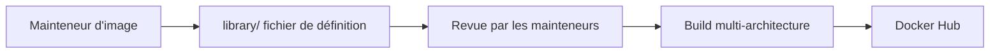

# docker-library/official-images

> The repository where official Docker images are decided, with their review and maintenance rules.

## The problem
Without a common framework, base images on Docker Hub vary in quality, security and startup behavior.

## What it actually does
It contains the library definition files (`library/`) that list the supported tags of each official image, and the guidelines for proposing one: reproducible repository, consistent `CMD` or `ENTRYPOINT`, download verification (PGP, checksum), tini for signals, multi-architecture (amd64, arm64v8, riscv64…). A proposed image is reviewed by the maintainers.

## How it is wired
Simplified diagram based on the sheet, no diagram provided.

## Trying it
No install command: usage means submitting a pull request on `library/`. To understand the format, the README gives an example file with `Maintainers`, `GitRepo`, `GitCommit`, `Tags`, `Architectures`.

## Cost and gotchas
Free, but proposing an image commits you to maintaining it and publishing fixes quickly. `Dockerfile`s must avoid `--privileged` and pin versions.

## What it is not
Not a tool to install nor images to clone. The README provided is truncated, so the detail of the library file format is not re-read here.

## Alternatives
No alternative named in the README.

## For you
Worth watching: serves as a reference of Dockerfile best practices (source verification, tini, multi-arch) to read before building your MLOps images.
