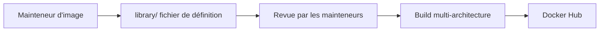

# docker-library/official-images

> Le dépôt où se décident les images Docker officielles, avec leurs règles de revue et de maintenance.

## Le problème
Sans cadre commun, les images de base sur Docker Hub varient en qualité, en sécurité et en comportement au démarrage.

## Ce que ça fait vraiment
Il contient les fichiers de définition de bibliothèque (`library/`) qui listent les tags supportés de chaque image officielle, et les consignes pour en proposer une : dépôt reproductible, `CMD` ou `ENTRYPOINT` cohérents, vérification des téléchargements (PGP, somme de contrôle), tini pour les signaux, multi-architecture (amd64, arm64v8, riscv64…). Une image proposée est relue par les mainteneurs.

## Comment c'est branché
Schéma simplifié d'après la fiche, sans diagramme fourni.

## Essayer
Aucune commande d'installation : l'usage est de proposer une pull request sur `library/`. Pour comprendre le format, le README donne un exemple de fichier avec `Maintainers`, `GitRepo`, `GitCommit`, `Tags`, `Architectures`.

## Coût et pièges
Gratuit, mais proposer une image engage à la maintenir et à publier vite les correctifs. Les `Dockerfile` doivent éviter `--privileged` et épingler les versions.

## Ce que ce n'est pas
Pas un outil à installer ni des images à cloner. Le README fourni est tronqué, donc le détail du format des fichiers de bibliothèque n'est pas relu ici.

## Alternatives
Aucune alternative nommée dans le README.

## Pour toi
À surveiller : sert de référence de bonnes pratiques Dockerfile (vérification des sources, tini, multi-arch) à relire avant de bâtir tes images MLOps.

