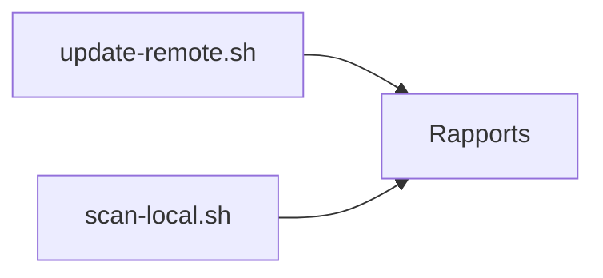

# docker-library/repo-info

> Scripts that generate extended information reports on the official Docker images.

## The problem
There is no detailed, up-to-date view of the contents of the published official images.

## What it actually does
The very short README mentions scripts `update-remote.sh` and `scan-local.sh` (one job per repository) that produce reports. It declares itself a work in progress. The rest is not documented.

## How it is wired

## Trying it
No command documented beyond the script names `update-remote.sh` and `scan-local.sh`.

## Cost and gotchas
Free; usage and outputs not documented. Insufficient material to judge.

## What it is not
Not an everyday tool: it is tooling internal to the official images.

## Alternatives
No alternative named in the README.

## For you
Ignore: README too thin and internal usage; nothing actionable for you.
