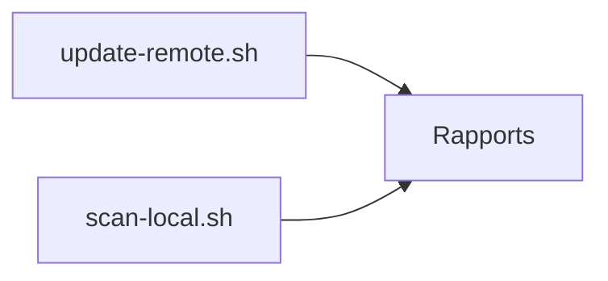

# docker-library/repo-info

> Scripts qui génèrent des rapports d'informations étendues sur les images officielles Docker.

## Le problème
Il manque une vue détaillée et à jour du contenu des images officielles publiées.

## Ce que ça fait vraiment
Le README, très court, mentionne des scripts `update-remote.sh` et `scan-local.sh` (un job par dépôt) qui produisent des rapports. Il se déclare en chantier. Le reste n'est pas documenté.

## Comment c'est branché

## Essayer
Aucune commande documentée au-delà des noms de scripts `update-remote.sh` et `scan-local.sh`.

## Coût et pièges
Gratuit ; usage et sorties non documentés. Matière insuffisante pour juger.

## Ce que ce n'est pas
Pas un outil d'usage courant : c'est de l'outillage interne aux images officielles.

## Alternatives
Aucune alternative nommée dans le README.

## Pour toi
À ignorer : README trop mince et usage interne ; rien d'actionnable pour toi.

