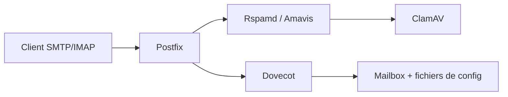

# docker-mailserver/docker-mailserver

> Complete mail server in a container (SMTP, IMAP, antispam, antivirus), configured through files, for self-hosters.

## The problem
Setting up a reliable mail server means assembling and maintaining Postfix, Dovecot, antispam, DKIM/DMARC and certificates by hand.

## What it actually does
A single container bundles Postfix (SMTP, LDAP), Dovecot (IMAP, POP3, Sieve, quotas), Rspamd, Amavis, SpamAssassin, ClamAV, OpenDKIM/OpenDMARC, Fail2ban, Postscreen, Postgrey. No SQL database: everything goes through configuration files that can be versioned. A `setup` script helps with maintenance; Let's Encrypt, manual and self-signed certificates are supported, as well as OAuth2.

## How it is wired

(Diagram derived from the README's list of services; no diagram was provided.)

## Trying it
The README contains no commands: it points to the online documentation (usage, examples, environment variables).

## Cost and gotchas
Free, but you need a domain, DNS records, a clean IP and an open port 25. Maintained by volunteers since January 2021; issues are not support tickets.

## What it is not
Not a turnkey solution: deliverability (IP reputation, SPF/DKIM) remains your responsibility. No web administration interface in the README.

## Alternatives
No alternative named in the README.

## For you
Unrelated to data/AI/MLOps work; ignore unless you have a mail self-hosting project.
