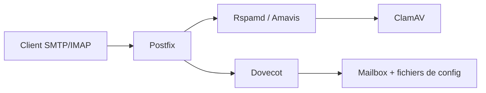

# docker-mailserver/docker-mailserver

> Serveur mail complet en conteneur (SMTP, IMAP, antispam, antivirus), configuré par fichiers, pour auto-hébergeurs.

## Le problème
Monter un serveur mail fiable impose d'assembler et de maintenir à la main Postfix, Dovecot, antispam, DKIM/DMARC et certificats.

## Ce que ça fait vraiment
Un seul conteneur regroupe Postfix (SMTP, LDAP), Dovecot (IMAP, POP3, Sieve, quotas), Rspamd, Amavis, SpamAssassin, ClamAV, OpenDKIM/OpenDMARC, Fail2ban, Postscreen, Postgrey. Pas de base SQL : tout passe par des fichiers de configuration versionnables. Un script `setup` aide à la maintenance ; Let's Encrypt, certificats manuels et auto-signés sont gérés, ainsi qu'OAuth2.

## Comment c'est branché

(Schéma issu de la liste de services du README ; aucun diagramme n'était fourni.)

## Essayer
Le README ne contient aucune commande : il renvoie à la documentation en ligne (usage, exemples, variables d'environnement).

## Coût et pièges
Gratuit, mais il faut un domaine, des enregistrements DNS, une IP propre et un port 25 ouvert. Maintenu par des bénévoles depuis janvier 2021 ; les tickets ne sont pas du support.

## Ce que ce n'est pas
Pas une solution clé en main : la délivrabilité (réputation IP, SPF/DKIM) reste à ta charge. Pas d'interface web d'administration dans le README.

## Alternatives
Aucune alternative nommée dans le README.

## Pour toi
Sans lien avec le travail data/IA/MLOps ; à ignorer sauf projet d'auto-hébergement de messagerie.

