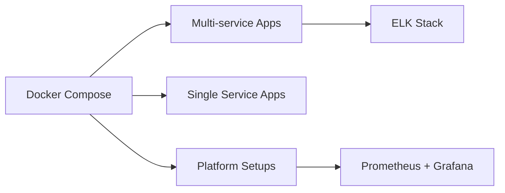

# docker/awesome-compose

> Collection of pre-built Docker Compose examples for a wide range of application stacks.

## The problem
Starting with a blank slate to connect nginx, a database, and a backend in a Compose file is time-consuming.

## What it actually does
Each folder contains example files with a corresponding `compose.yaml` file: multi-service stacks (Flask, Go, React, Spring + base), standalone services (Django, FastAPI, Plex, Wireguard), and platform configurations (Nextcloud, Prometheus/Grafana, Gitea, WordPress). The README indicates that these are examples for local development, not for production use.

## How it is wired


## Trying it
```console
docker compose up -d
docker compose down
```

## Cost and gotchas
Free. Requires Docker and Docker Compose. Not intended for direct deployment in a production environment.

## What it is not
Not a tool or a framework: a list of examples. There is no mention of a machine learning model or an MLOps stack in the table of contents, except for Prometheus/Grafana.

## Alternatives
No alternative is specified in the README file.

## For you
Things to watch out for: a good starting point for setting up Prometheus/Grafana, or for using a local instance of FastAPI, before building your own stack.
