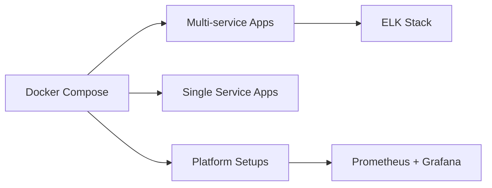

# docker/awesome-compose

> Collection d'exemples Docker Compose prêts à lancer pour de nombreuses piles applicatives.

## Le problème
Partir d'une feuille blanche pour relier nginx, une base et un backend dans un fichier Compose fait perdre du temps.

## Ce que ça fait vraiment
Dossiers d'exemples avec un `compose.yaml` chacun : piles multi-services (Flask, Go, React, Spring + base), services seuls (Django, FastAPI, Plex, Wireguard) et configurations de plateformes (Nextcloud, Prometheus/Grafana, Gitea, WordPress). Le README prévient que ce sont des exemples de développement local, pas de la production.

## Comment c'est branché


## Essayer
```console
docker compose up -d
docker compose down
```

## Coût et pièges
Gratuit. Docker et Docker Compose requis. À ne pas déployer tel quel en production.

## Ce que ce n'est pas
Pas un outil ni un framework : une liste d'exemples. Pas de modèle ML ni de pile MLOps dans le sommaire sauf Prometheus/Grafana.

## Alternatives
Aucune alternative nommée dans le README.

## Pour toi
À surveiller : bon point de départ pour monter Prometheus/Grafana, une base ou FastAPI en local avant de construire ta propre pile.

