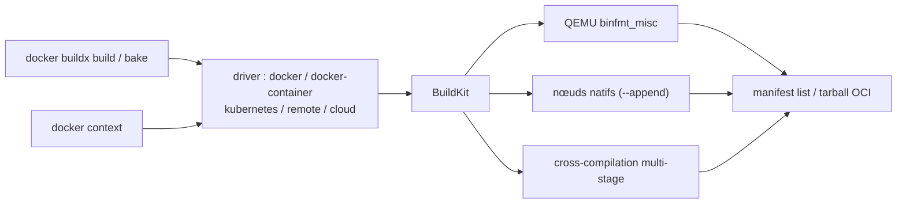

# docker/buildx

> Docker CLI plugin that extends `docker build` with all the capabilities of BuildKit.

## The problem
The classic `docker build` cannot build a multi-architecture image, spread a build across several nodes, export to an OCI tarball, or share a distributed cache.

## What it actually does
Gives the same experience as `docker build` on the BuildKit engine, without `DOCKER_BUILDKIT=1`, while adding isolated builder instances, multi-node builds, Compose support and high-level builds with Bake. Each driver defines where and how the build runs, with a different feature set: `docker`, `cloud`, `docker-container`, `kubernetes`, `remote`. Instances are created with `docker buildx create`, can be inspected, stopped, removed, listed, and extended with `--append`; they integrate with `docker context`, each context getting a default builder. Three strategies for multi-platform: QEMU emulation via `binfmt_misc`, multiple native nodes in the same builder, or multi-stage cross-compilation with `BUILDPLATFORM` and `TARGETPLATFORM`.

## How it is wired


## Trying it
```bash
docker buildx build .
docker buildx bake "https://github.com/docker/buildx.git"
mkdir -p ~/.docker/cli-plugins
mv ./bin/build/buildx ~/.docker/cli-plugins/docker-buildx
git clone https://github.com/docker/buildx.git && cd buildx && make install
chmod +x ~/.docker/cli-plugins/docker-buildx
docker run --privileged --rm tonistiigi/binfmt --install all
docker buildx create --use --name mybuild node-amd64
docker buildx create --append --name mybuild node-arm64
docker buildx build --platform linux/amd64,linux/arm64 .
docker buildx ls
```

## Cost and gotchas
Free, but requires Docker Engine 19.03+ — an incompatible version produces unexpected behavior, especially with a recent BuildKit. A manually downloaded binary does not receive security fixes: keep it for testing only. For QEMU to work transparently in containers, the binaries must be registered with the `fix_binary` flag (kernel ≥ 4.8, binfmt-support ≥ 2.1.7), to be checked in `/proc/sys/fs/binfmt_misc/qemu-*`.

## What it is not
Not a build engine: BuildKit does the work, buildx is the driver. Simultaneous multi-platform builds are only possible with the `cloud`, `docker-container`, `kubernetes` or `remote` drivers — not with the default `docker` driver. Installing the same-named package via brew is not this project.

## Alternatives
- `docker build` with `DOCKER_BUILDKIT=1`: enough for a single architecture.

## For you
Essential as soon as you publish an image that has to run on arm64 as well as amd64.
