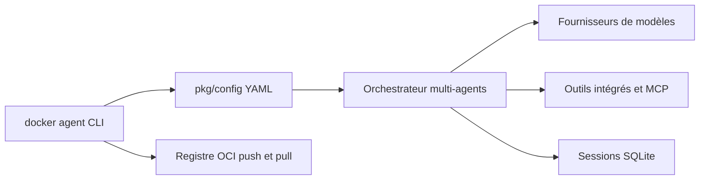

# docker/cagent

> Docker Agent: a CLI plugin that runs AI agents described in YAML, alone or as a team.

## The problem
Assembling agents, tools and a model provider takes glue code in every project.

## What it actually does
A YAML file describes the model, instructions and tools (local, remote or Docker MCP, built-in think, todo and memory tools). Multi-agent with delegation, RAG (BM25, embeddings, hybrid), providers OpenAI, Anthropic, Gemini, Bedrock, Mistral, xAI and Docker Model Runner. Agents are pushed to and pulled from an OCI registry.

## How it is wired


## Trying it
```sh
export OPENAI_API_KEY=sk-...
docker agent run agent.yaml
docker agent new
docker agent run myorg/agent:tag
```

## Cost and gotchas
At least one API key, or Docker Model Runner for a local model. Docker Desktop 4.63+ includes it; otherwise Homebrew or a binary. Anonymous telemetry is collected (see the dedicated page).

## What it is not
Not a code framework: "no code" amounts to writing YAML. An agent running shell or file operations calls for caution.

## Alternatives
No alternative named in the README.

## For you
Adopt: versionable YAML and an OCI registry suit an MLOps profile well; disable or check the telemetry and the license.
