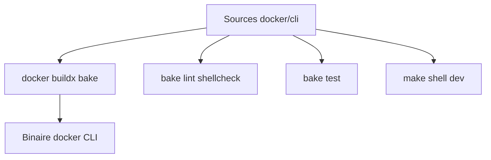

# docker/cli

> The repository of the Docker command-line client.

## The problem
(The README poses no problem: it is the source code of a ubiquitous tool, oriented toward development/contribution.)

## What it actually does
Hosts the Docker CLI code. The README mostly covers the build: compiling from source with `docker buildx bake`, cross-compiling for all platforms, dynamic glibc/musl builds, lint, unit and full tests, development environment in a container (`make shell`). Under the Apache 2.0 license.

## How it is wired


## Trying it
```shell
docker buildx bake
```
```shell
docker buildx bake test
```

## Cost and gotchas
Free (Apache 2.0). Use/transfer of Docker may be subject to US export restrictions (see NOTICE). README purely oriented toward contribution, no product usage.

## What it is not
Not documentation on using Docker: the repository of the CLI code, for those who build or modify it.

## Alternatives
Not named in the README.

## For you
No direct practical interest unless you contribute to the Docker CLI itself — ignore.
