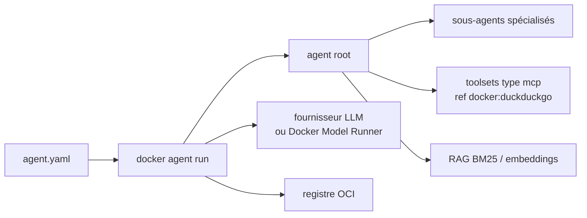

# docker/docker-agent

> Docker CLI plugin that defines and runs AI agents in YAML, for developers already equipped with Docker.

## The problem
Assembling a team of agents requires glue code: orchestration, delegation, tools, retrieval.
Nothing is versionable or simply shareable.

## What it actually does
Declarative definition in YAML (`agents.root`: model, description, instruction, toolsets).
Multi-agent architecture with automatic delegation. Built-in tools (think, todo, memory) plus
any MCP server, local, remote or Docker. Pluggable RAG: BM25, embeddings, hybrid, reranking.
Provider-agnostic: OpenAI, Anthropic, Gemini, AWS Bedrock, Mistral, xAI, Docker Model Runner.
Publishing and running from any OCI registry.

## How it is wired


## Trying it
```bash
brew install docker-agent
export OPENAI_API_KEY=sk-...
docker agent run agent.yaml
docker agent new
docker agent run myorg/agent:tag
```

## Cost and gotchas
Pre-installed with Docker Desktop 4.63+. Provider's bill at your expense, except with local models
via Docker Model Runner. The README announces anonymous usage data collection.

## What it is not
Not a model or an inference runtime: you need a key or a local model.
Not independent of the Docker ecosystem. The advanced capabilities (MCP mode, TUI, RAG)
are described only in the external documentation, not in the README.

## Alternatives
Docker Model Runner, cited for local inference instead of a cloud key.

## For you
Worth trying if your team already lives in Docker: versioned YAML beats an orchestration script.
