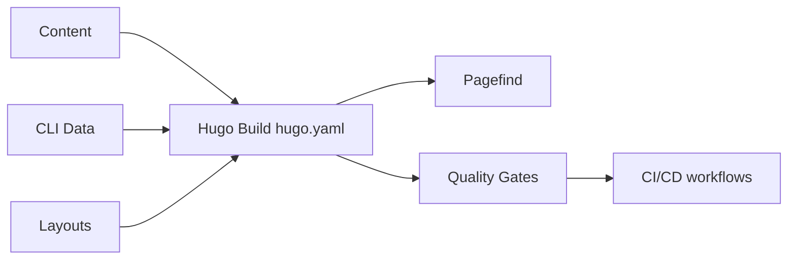

# docker/docs

> Sources of Docker's official documentation site, for contributors and writers.

## The problem
Docker's documentation must stay open to community corrections while still being validated.

## What it actually does
A Hugo repository: Markdown under `content/` (get-started, guides, manuals, reference), structured data under `data/` (generated CLI references), `layouts/` templates. Pagefind indexes the search. Lint (Vale, markdownlint, Prettier, htmltest), GitHub Actions CI, deployment via Netlify.

## How it is wired

## Trying it
No command documented in the README: see CONTRIBUTING.md.

## Cost and gotchas
Free to contribute. Custom support via paid Docker subscriptions (outside the repository).

## What it is not
Not a Docker tool: it is the source code of the docs site.

## Alternatives
No alternative named in the README.

## For you
Ignore as a repository to install; consult the published site, and the repository only to fix the docs.
