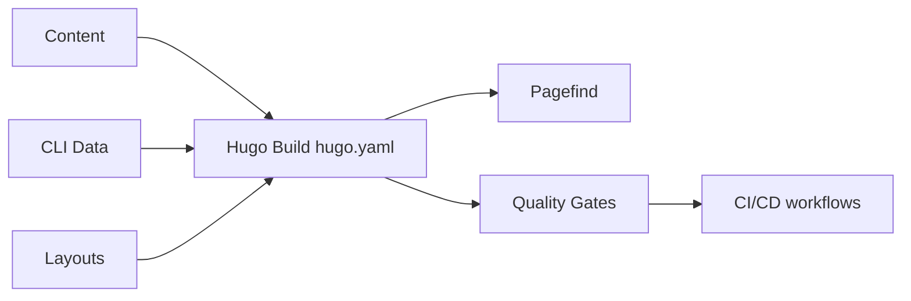

# docker/docs

> Sources du site de documentation officiel de Docker, pour contributeurs et rédacteurs.

## Le problème
La documentation Docker doit rester ouverte aux corrections de la communauté tout en étant validée.

## Ce que ça fait vraiment
Dépôt Hugo : Markdown sous `content/` (get-started, guides, manuals, reference), données structurées sous `data/` (références CLI générées), templates `layouts/`. Pagefind indexe la recherche. Lint (Vale, markdownlint, Prettier, htmltest), CI GitHub Actions, déploiement via Netlify.

## Comment c'est branché

## Essayer
Aucune commande documentée dans le README : voir CONTRIBUTING.md.

## Coût et pièges
Gratuit pour contribuer. Support personnalisé via abonnements Docker payants (hors dépôt).

## Ce que ce n'est pas
Pas un outil Docker : c'est le code source du site de doc.

## Alternatives
Aucune alternative nommée dans le README.

## Pour toi
À ignorer comme dépôt à installer ; consulte le site publié, et le dépôt seulement pour corriger la doc.

