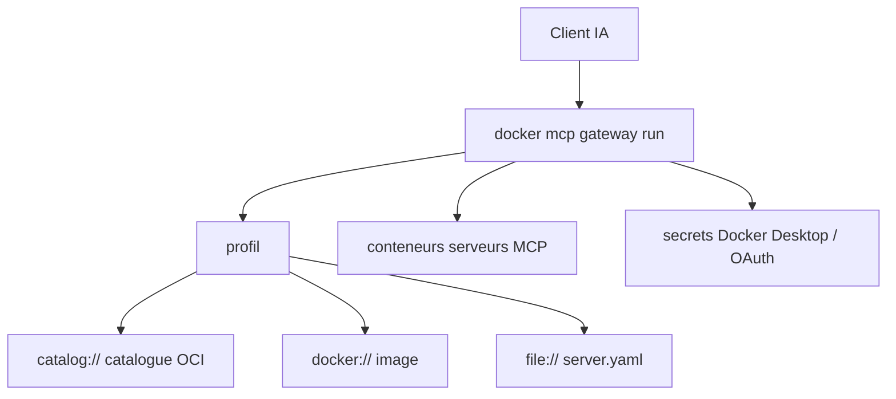

# docker/mcp-gateway

> Docker CLI plugin that runs MCP servers in isolated containers behind a single gateway.

## The problem
Each AI client configures its MCP servers on its own, with API keys in plain text in environment variables.
npx and uvx servers run with the host machine's privileges, with no isolation.

## What it actually does
Groups servers into **profiles** that reference an OCI catalog, a Docker image, the public MCP registry or a local file.
Each catalog server runs in its own container; npx and uvx get minimal host privileges.
Exposes a single gateway (stdio, sse or streaming) shared by all clients — VS Code, Cursor, Claude Desktop, Claude Code.
Handles secrets through Docker Desktop, OAuth flows, dynamic tool discovery and a per-profile tool allowlist.

## How it is wired


## Trying it
```bash
git clone https://github.com/docker/mcp-gateway.git
cd mcp-gateway
mkdir -p "$HOME/.docker/cli-plugins/"
make docker-mcp
docker mcp catalog pull mcp/docker-mcp-catalog
docker mcp gateway run --profile dev-tools
```

## Cost and gotchas
Docker Desktop 4.59+ with MCP Toolkit expected; outside Desktop (WSL2, Docker CE), set `DOCKER_MCP_IN_CONTAINER=1` and enable `docker mcp feature enable profiles`.
Go 1.24+ only if you build the plugin yourself.

## What it is not
Not an MCP server: it is the infrastructure that runs others.
Not independent of Docker: the isolation model is the container, with no plan B without a Docker daemon.
`docker mcp secret export` remains a temporary requirement for Docker Cloud runs.

## Alternatives
No alternative named in the README.

## For you
If you are accumulating MCP servers, this is the most direct way to isolate them and share a single configuration across clients.
