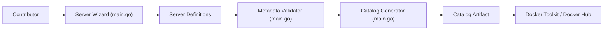

# docker/mcp-registry

> Official catalogue of MCP servers published by Docker, run in isolated containers.

## The problem
Finding reliable MCP servers and running them without exposing your machine to unverified code is difficult.

## What it actually does
A contributor proposes by pull request the metadata of a server, either built by Docker (signatures, provenance, SBOM, publication as `mcp/<name>` on Docker Hub) or an already built image. The definitions are validated, a catalogue is generated, then read by the MCP catalogue, Docker Desktop's MCP Toolkit and Docker Hub. The repository also contains creation wizards and an AI-assisted security review tool.

## How it is wired

## Trying it
No command in the README: contributing goes through a pull request with the required information; changes and removals go through an issue.

## Cost and gotchas
Free. The announced delay between approval and appearance in the catalogue is 24 hours. Contributor-supplied images do not have the hardened protections (signatures, SBOM). 1,318 open issues.

## What it is not
Not hosting for MCP servers nor an absolute security guarantee: non-compliant servers can be removed, but the review remains a quality check.

## Alternatives
No alternative cited in the README.

## For you
Worth watching as a source of container-isolated MCP servers, useful for framing what your agents can launch; to consult rather than to clone.
