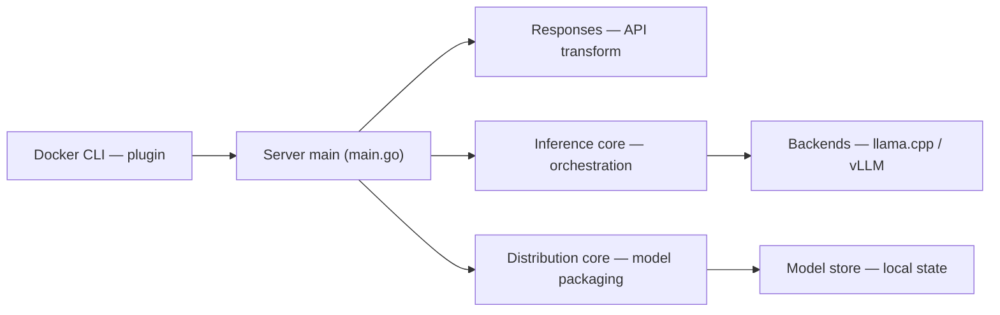

# docker/model-runner

> Docker runtime to download, run and serve AI models from Docker Hub or any OCI registry.

## The problem
Serving an LLM locally means assembling an inference engine, weights and an API, with no common workflow.

## What it actually does
A Go server exposes a REST API for model management, OpenAI-compatible endpoints (and Ollama according to the code), Prometheus metrics and logs. The scheduler picks a backend: llama.cpp by default, vLLM, SGLang, diffusers or MLX. The `docker model` plugin, the standalone `dmr` binary and an experimental Helm chart complete the whole.

## How it is wired


## Trying it
```bash
docker model run ai/gemma3 "Hello"
brew install docker/tap/dmr
./dmr serve &
./dmr pull ai/gemma3
make docker-run PORT=3000 MODELS_PATH=/path/to/your/models
```

## Cost and gotchas
Included in Docker Desktop and Docker Engine; the CUDA/ROCm variants require a suitable base image. The README is truncated at the end of the dmrlet section. 75 open issues. Port 12434 is the one used by Docker Desktop.

## What it is not
Not a managed service nor a large-scale orchestrator; Kubernetes support is experimental. NIM containers require an NGC key.

## Alternatives
No alternative cited in the README.

## For you
Adopt it for local inference and testing: OpenAI-compatible API, models packaged like OCI images, already present in Docker Desktop.
