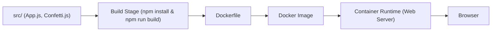

# docker/welcome-to-docker

> Small React demo application served in a container, for getting started with Docker.

## The problem
A Docker beginner needs a first container that displays something in the browser.

## What it actually does
Minimal README (under 800 characters). It gives a `docker run` command that exposes port 8088 and a local build procedure. Judging from the code, it is a React SPA (App.js, Confetti.js) served statically, with no backend.

## How it is wired


## Trying it
```bash
docker run -d -p 8088:80 --name welcome-to-docker docker/welcome-to-docker
docker build -t welcome-to-docker .
docker run -d -p 8088:3000 --name welcome-to-docker welcome-to-docker
```

## Cost and gotchas
Nothing to pay; Docker is required. The container port differs between the published image (80) and the local build (3000).

## What it is not
Neither a detailed tutorial nor an application template: the README points to MAINTAINERS.md for maintenance. No license declared in the catalog.

## Alternatives
No alternative cited in the README.

## For you
Ignore: it is a Docker welcome demo, with no value for a data / AI profile, and no explicit license.
