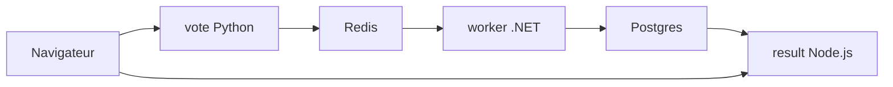

# dockersamples/example-voting-app

> Sample multi-container voting app for learning Docker Compose, Swarm and Kubernetes.

## The problem
Single-container Docker tutorials show neither message queues, nor a persistent database, nor multiple languages.

## What it actually does
A voting app in Python, a Redis that collects the votes, a .NET worker that stores them in Postgres, and a Node.js app that displays the results live. It deploys with Compose, Swarm or Kubernetes manifests. One vote per browser.

## How it is wired


## Trying it
```bash
docker compose up
docker stack deploy --compose-file docker-stack.yml vote
kubectl create -f k8s-specifications/
```

## Cost and gotchas
Free. Vote on port 8080, results on 8081 (31000 and 31001 under Kubernetes). Last push in October 2024.

## What it is not
The README says so itself: this is not an exemplary architecture, just a demonstration of varied pieces.

## Alternatives
No alternative named in the README.

## For you
Worth watching: a good sandbox for testing containers and manifests, but never a production model.
