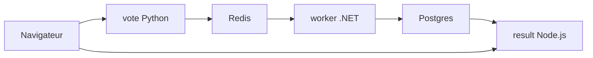

# dockersamples/example-voting-app

> Appli de vote multi-conteneurs d'exemple pour apprendre Docker Compose, Swarm et Kubernetes.

## Le problème
Les tutoriels Docker à un seul conteneur ne montrent ni files de messages, ni base persistante, ni plusieurs langages.

## Ce que ça fait vraiment
Une appli de vote en Python, un Redis qui collecte les votes, un worker .NET qui les stocke dans Postgres, et une appli Node.js qui affiche les résultats en direct. Elle se déploie avec Compose, Swarm ou des manifestes Kubernetes. Un seul vote par navigateur.

## Comment c'est branché


## Essayer
```bash
docker compose up
docker stack deploy --compose-file docker-stack.yml vote
kubectl create -f k8s-specifications/
```

## Coût et pièges
Gratuit. Vote sur le port 8080, résultats sur 8081 (31000 et 31001 sous Kubernetes). Dernier push en octobre 2024.

## Ce que ce n'est pas
Le README le dit : ce n'est pas une architecture exemplaire, juste une démonstration de pièces variées.

## Alternatives
Aucune alternative nommée dans le README.

## Pour toi
À surveiller : bon bac à sable pour tester conteneurs et manifestes, mais jamais un modèle de production.

