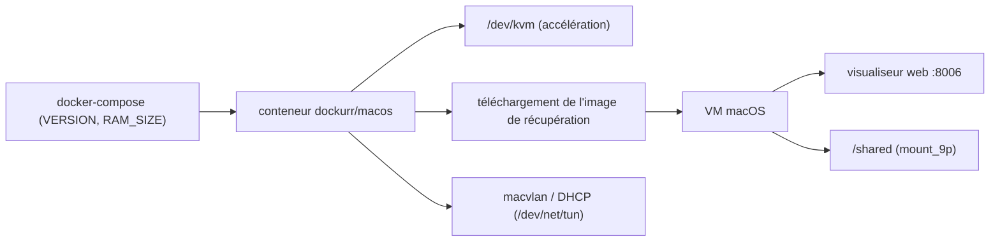

# dockur/macos

> macOS in a Docker container, with automatic download of the installation files.

## The problem
Testing something on macOS without an available Mac means setting up a VM by hand, finding the
installation images and configuring networking and display.

## What it actually does
The container downloads the recovery image, exposes a web viewer on port 8006 and lets you run the
installation from the recovery menu (APFS formatting via Disk Utility, then "Reinstall macOS"). KVM
acceleration, configurable CPU/RAM/disk (`RAM_SIZE`, `CPU_CORES`, `DISK_SIZE`), memory ballooning,
USB device and disk passthrough, folder sharing via `mount_9p`, NAT, user-mode, macvlan and macvtap
networks, DHCP. Versions 11 to 15 selectable through `VERSION`.

## How it is wired


## Trying it
```bash
docker run -it --rm --name macos -e "VERSION=14" -p 8006:8006 --device=/dev/kvm --device=/dev/net/tun --cap-add NET_ADMIN -v "${PWD:-.}/macos:/storage" --stop-timeout 120 docker.io/dockurr/macos
sudo apt install cpu-checker
sudo kvm-ok
```

## Cost and gotchas
Linux host with KVM, AVX2 processor, 4 GB of RAM and 32 GB of disk minimum. Docker Desktop on Linux,
macOS and Windows 10 gives no access to KVM and is not supported. On AMD, the README advises against
several cores or more than 8 GB at first: instability and freezing at the country selection. macOS 26
is selectable but discouraged, very slow for an unknown reason.

## What it is not
Not legal everywhere: the README is explicit — Apple's EULA forbids installation on unofficial
hardware, so the container must only run on hardware sold by Apple. The project does not distribute
macOS and bypasses no protection. Nor is it an automatic installation: a dozen manual steps must be
followed in the viewer.

## Alternatives
- `dockur/windows`: the same principle for Windows, with fully automatic installation.
- `qemus/qemu`: for a Linux desktop in a container.

## For you
No professional use here, and the EULA constraint is enough to close the subject.
