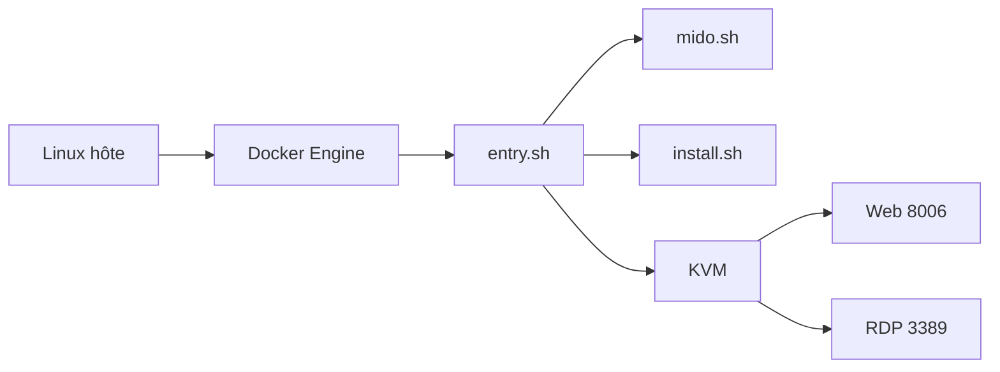

# dockur/windows

> Runs Windows within a Docker container, with automatic installation and access via a web browser or RDP.

## The problem
Sometimes, it's necessary to have a bootable Windows installation on a Linux host without manually setting up a virtual machine or an ISO.

## What it actually does
A container downloads the selected ISO (variable `VERSION`), installs Windows without user intervention using QEMU/KVM, exposes a web viewer on port 8006 and RDP on 3389. Disk, CPU, RAM, USB, shared folder, and macvlan network are configurable using environment variables.

## How it is wired


## Trying it
```bash
docker run -it --rm --name windows -e "VERSION=11" -p 8006:8006 --device=/dev/kvm --device=/dev/net/tun --cap-add NET_ADMIN -v "${PWD:-.}/windows:/storage" --stop-timeout 120 docker.io/dockurr/windows
```

## Cost and gotchas
Free, but you need to purchase a Windows license. Requires a KVM, 2GB of RAM, and 32GB of storage. Default credentials are `Docker` / `admin`. Do not connect a USB drive before the installation is complete: this could result in formatting.

## What it is not
There is no Docker Desktop for Linux/macOS/Windows 10 (no KVM). This is not a Windows license. The README does not specify the name of the license for the repository; the catalog indicates MIT.

## Alternatives
dockur/windows-arm (ARM64), dockur/macos (macOS), qemus/qemu (Linux desktop).

## For you
Not relevant for data/AI: useful if you need to run a specific Windows application from a Linux server, but not for MLOps.
