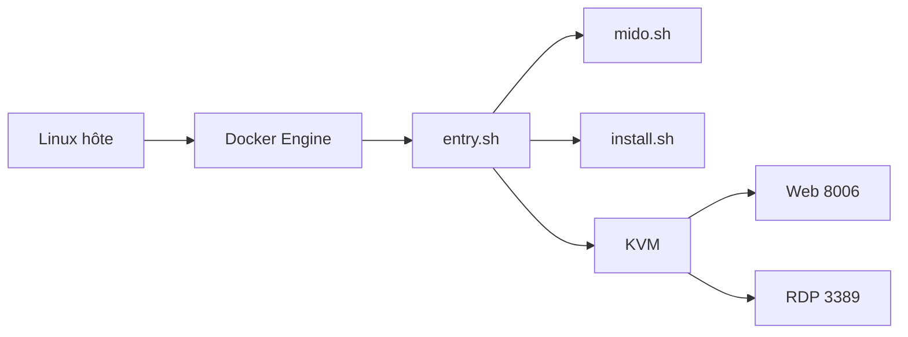

# dockur/windows

> Fait tourner Windows dans un conteneur Docker, installation automatique, accès par navigateur ou RDP.

## Le problème
Il faut parfois un Windows jetable sur un hôte Linux sans monter à la main une VM ni une ISO.

## Ce que ça fait vraiment
Un conteneur télécharge l'ISO choisie (variable `VERSION`), installe Windows sans intervention via QEMU/KVM, expose un visualiseur web sur le port 8006 et RDP sur 3389. Disque, CPU, RAM, USB, dossier partagé, réseau macvlan configurables par variables d'environnement.

## Comment c'est branché


## Essayer
```bash
docker run -it --rm --name windows -e "VERSION=11" -p 8006:8006 --device=/dev/kvm --device=/dev/net/tun --cap-add NET_ADMIN -v "${PWD:-.}/windows:/storage" --stop-timeout 120 docker.io/dockurr/windows
```

## Coût et pièges
Gratuit mais Windows doit être licencié par toi. Il faut KVM, 2 Go de RAM, 32 Go de disque. Identifiants par défaut `Docker` / `admin`. Ne branche pas de disque USB avant la fin de l'installation : risque de formatage.

## Ce que ce n'est pas
Pas de Docker Desktop sur Linux/macOS/Windows 10 (pas de KVM). Pas une licence Windows. Le README ne précise pas le nom de licence du dépôt ; le catalogue indique MIT.

## Alternatives
dockur/windows-arm (ARM64), dockur/macos (macOS), qemus/qemu (bureau Linux).

## Pour toi
À ignorer pour la data/IA : utile si tu dois exécuter un logiciel Windows ponctuel depuis un serveur Linux, pas pour du MLOps.

